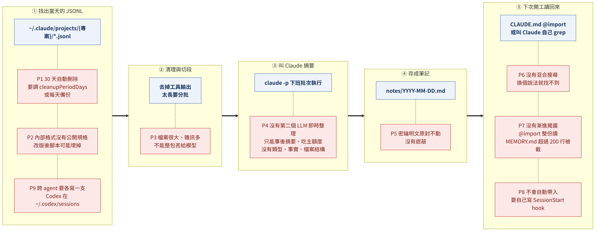
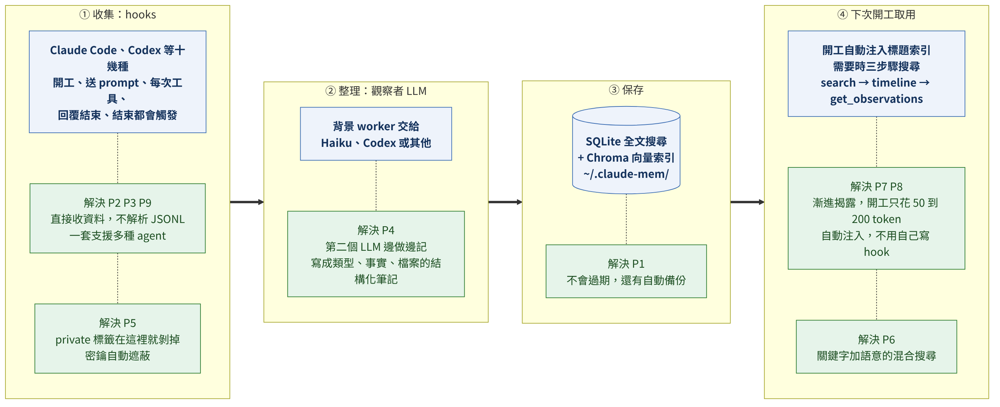

# claude-mem 自動日報

用 **Claude Code + [claude-mem](https://docs.claude-mem.ai/introduction)**，每天下班自動產出個人日報，週五彙整週報、月底彙整月報；有會議錄音的話，先用 WhisperX 轉成分人逐字稿，再整理成會議紀錄一併寫進日報。主管端可以再把全團隊的日報、週報彙整成一份。

Mac 與 Windows 都有排程腳本。

> claude-mem 是社群開源專案，不是 Anthropic 官方工具。本 repo 為教學範例，導入團隊前請先小規模試行。

## 教學：從 Claude Code 到 claude-mem

先讓學員撞牆，再給解藥：用同一個問題，比較原生記憶和 claude-mem，再看用 JSONL 自己做會碰到哪些坑。完整教案見 [docs/claude-code-to-claude-mem.md](docs/claude-code-to-claude-mem.md)。





## 自動日報流程

```
上班：Claude Code / Codex 工作 ── claude-mem 自動記錄
                                        │
19:00 排程 ─► recordings/ 有新錄音？──► WhisperX 逐字稿 ─► Claude 整理會議紀錄
                                        │
                                        ▼
                     Claude 用 claude-mem 搜尋今天紀錄 ─► reports/daily/YYYY-MM-DD.md
                                                          （每項附紀錄 ID 與檔案路徑）
週五 19:30 ─► 日報彙整成週報 ─► reports/weekly/YYYY-Www.md
月底 20:00 ─► 週報彙整成月報 ─► reports/monthly/YYYY-MM.md
主管端 ─► 全員日報、週報彙整 ─► reports/team/
```

## 目錄

| 路徑 | 內容 |
| --- | --- |
| `docs/claude-code-to-claude-mem.md` | **教學模組：從 Claude Code 原生記憶到 claude-mem**（8 張流程圖：原生三層、撞牆實驗、JSONL 自己做的坑、claude-mem 管線、記憶方案地圖、決策樹、分工、舊專案銜接） |
| `docs/doc-retrieval-and-memory.md` | 文件檢索與長期記憶：三條檢索路線、去重流程、搭配 claude-mem（3 張流程圖） |
| `docs/claude-mem-zh-tw.md` | claude-mem 官方文件繁中重點整理（含常見問答、兩種做法比較） |
| `docs/team-report-architecture.md` | 團隊自動化日報／週報系統架構 |
| `docs/images/` | 所有流程圖的 PNG，投影片可直接用 |
| `prompts/` | 日報、週報、月報、會議紀錄、主管彙整的 prompt，改這裡就能調整報告格式 |
| `config/` | claude-mem 設定範例、排程設定範例、說話者對照範例 |
| `scripts/mac/` | Mac 執行腳本與 launchd 排程安裝 |
| `scripts/windows/` | Windows 執行腳本與工作排程器註冊 |
| `scripts/transcribe/` | WhisperX 錄音轉逐字稿 |
| `recordings/` | 放會議錄音，檔名格式 `YYYY-MM-DD_會議名稱.m4a` |
| `meetings/`、`reports/`、`logs/` | 產出的逐字稿、會議紀錄、報告與執行紀錄（不進 git） |

## 快速開始

### 1. 共同準備（Mac、Windows 都要）

1. 安裝 [Claude Code](https://docs.claude.com/en/docs/claude-code/overview) 並登入，版本要 2.1.139 以上（`claude update`）。
2. 安裝 Node.js 20.19 以上或 22.12 以上。
3. 安裝 claude-mem，在選單勾選你用的 agent（例如 Claude Code 和 Codex）：
   ```
   npx claude-mem install
   ```
   不要用 `npm install -g claude-mem`，那樣不會註冊 hooks。
4. 合併設定：把 `config/claude-mem-settings.example.json` 的內容合併進 `~/.claude-mem/settings.json`（Windows 是 `%USERPROFILE%\.claude-mem\settings.json`），刪掉底線開頭的說明欄位，再重啟 worker。
   - 範例預設用 Codex 整理筆記，要先執行 `codex login`；不用 Codex 就把 `CLAUDE_MEM_PROVIDER` 改成 `claude`。
5. 複製排程設定並修改：
   ```
   cp config/report.env.example config/report.env
   ```
   Windows：`Copy-Item config\report.env.example config\report.env`
6. **查出 claude-mem 搜尋工具的名稱**（重要）：在 Claude Code 裡執行 `/mcp`，找到 claude-mem 的搜尋伺服器，把 `mcp__<伺服器名稱>` 加到 `report.env` 的 `ALLOWED_TOOLS`。沒加的話，排程執行時 Claude 沒有權限用搜尋工具，日報會是空的。

### 2a. Mac

```bash
chmod +x scripts/mac/*.sh
bash scripts/mac/run-report.sh daily          # 先手動跑一次測試
tail -n 40 logs/$(date +%Y-%m-%d)-daily.log   # 看執行紀錄
bash scripts/mac/install-schedule.sh          # 安裝排程（主管加 --team）
```

移除排程：`bash scripts/mac/install-schedule.sh --uninstall`

### 2b. Windows

用 PowerShell 在 repo 資料夾執行：

```powershell
powershell -ExecutionPolicy Bypass -File .\scripts\windows\run-report.ps1 -Type daily   # 先手動跑一次
Get-Content .\logs\$(Get-Date -Format yyyy-MM-dd)-daily.log -Tail 40                    # 看執行紀錄
powershell -ExecutionPolicy Bypass -File .\scripts\windows\register-schedule.ps1        # 註冊排程（主管加 -Team）
```

排程會出現在「工作排程器」的 `ClaudeMemDailyReport` 資料夾。移除：加上 `-Uninstall`。

### 排程時間

| 工作 | 時間 | 說明 |
| --- | --- | --- |
| daily | 週一到週五 19:00 | 先處理新錄音，再寫日報 |
| weekly | 週五 19:30 | 彙整本週日報 |
| monthly | 每天 20:00 | 只在月底最後一天真正執行 |
| team-daily | 週一到週五 20:00 | 主管端，`--team` / `-Team` 才會安裝 |
| team-weekly | 週五 21:00 | 主管端 |

電腦在排程時間要開著；錯過的工作會在開機後補跑。要改時間，直接改 `install-schedule.sh` 或 `register-schedule.ps1` 裡的時間。

## 選用：會議錄音轉會議紀錄

Claude 模型不能直接讀音檔，所以先用本機的 WhisperX 轉成逐字稿。

1. 安裝 ffmpeg：Mac `brew install ffmpeg`，Windows `winget install Gyan.FFmpeg`。
2. 建立虛擬環境並安裝 WhisperX（腳本會自動使用 `.venv-whisper`）：
   - Mac：
     ```bash
     python3 -m venv .venv-whisper
     .venv-whisper/bin/pip install -r scripts/transcribe/requirements.txt
     ```
   - Windows：
     ```powershell
     py -m venv .venv-whisper
     .venv-whisper\Scripts\pip install -r scripts\transcribe\requirements.txt
     ```
3. 要分辨說話者的話，到 Hugging Face 申請 token、同意 pyannote 模型的使用條款，填進 `report.env` 的 `HF_TOKEN`。
4. 想把「SPEAKER_00」換成真名：複製 `config/speakers.example.json` 成 `config/speakers.json` 並修改。
5. 錄音檔依 `YYYY-MM-DD_會議名稱.m4a` 命名放進 `recordings/`，下次日報排程就會自動處理。

客戶會議請在本機轉檔，錄音前先取得與會者同意。

## 選用：記錄到 Notion 或 Jira

送到 Notion 有兩條線，用途不同，可以兩條都接：

| | A. 原始紀錄 | B. 報告摘要 |
| --- | --- | --- |
| 送的是 | claude-mem 每一筆紀錄 | 寫好的日報、週報、月報 |
| 誰送的 | claude-mem 背景服務，不經 Claude | 排程裡的 Claude，透過 Notion MCP |
| 給誰看 | 當證據，摘要裡的來源可以追溯到這裡 | 給人讀，主管看這個 |
| 支援 | 只有 Notion | Notion 或 Jira |

### A. 原始紀錄：claude-mem 內建的 Notion 匯出

1. 到 [notion.so/profile/integrations](https://www.notion.so/profile/integrations) 按 **New integration**，選工作區，權限勾 *Read content*、*Update content*、*Insert content*，複製 **Internal Integration Secret**（`ntn_` 開頭）。
2. 在 Notion 建一個資料庫，例如「原始紀錄庫」。欄位不用自己建，claude-mem 第一次執行時會自動補上。
3. 打開資料庫，右上角 **•••** → **Connections** → 加入剛剛的 integration。**這步沒做會回 404，匯出會自動關閉。**
4. 複製資料庫網址。
5. 在 `~/.claude-mem/settings.json`（Windows：`%USERPROFILE%\.claude-mem\settings.json`）加入：
   ```json
   "CLAUDE_MEM_NOTION_ENABLED": "true",
   "CLAUDE_MEM_NOTION_TOKEN": "ntn_貼上你的secret",
   "CLAUDE_MEM_NOTION_DATABASE_ID": "貼上資料庫網址"
   ```
6. 重啟 claude-mem 的 worker（最簡單是重開 Claude Code），用 Claude Code 做點事，Notion 就會開始出現紀錄。

注意：只會匯出設定之後的新紀錄，舊的歷史不會補；錯誤會寫在 `~/.claude-mem/logs/` 裡標 `NOTION` 的那幾行。

### B. 報告摘要：Claude Code 接 Notion 官方 MCP

1. **建報告庫**：在 Notion 建一個資料庫，例如「團隊報告庫」，建議欄位：

   | 欄位 | 類型 |
   | --- | --- |
   | 名稱（標題） | Title |
   | 成員 | Select 或 Text |
   | 類型 | Select：日報、週報、月報 |
   | 日期 | Date |
   | 需要協助 | Checkbox |

   欄位名稱可以不同，Claude 會依實際欄位填寫，沒有的欄位就略過。

2. **加入 Notion MCP**（加 `--scope user`，排程從 repo 資料夾執行時才讀得到）：
   ```bash
   claude mcp add --transport http --scope user notion https://mcp.notion.com/mcp
   ```
3. **登入授權**：打開 Claude Code，輸入 `/mcp`，選 notion，在瀏覽器完成授權並選擇工作區。
4. **修改 `config/report.env`**：
   ```
   REPORT_DESTINATION=notion
   NOTION_REPORT_DB=https://www.notion.so/你的報告庫網址
   ALLOWED_TOOLS=Read,Write,Edit,Glob,Grep,mcp__<claude-mem搜尋伺服器名稱>,mcp__notion
   ```
5. **測試**：手動跑一次日報（Mac：`bash scripts/mac/run-report.sh daily`；Windows：`.\scripts\windows\run-report.ps1 -Type daily`），看 log 最後一行有沒有寫「已送到 Notion」，再到報告庫確認。同一天重跑會更新同一頁，不會重複新增。

### Jira（只支援報告摘要）

claude-mem 沒有內建 Jira 匯出，所以 Jira 只能走 B 這條線，做法是把報告貼成某個 issue 的留言：

1. 加入 Atlassian 官方 MCP，再用 `/mcp` 登入：
   ```bash
   claude mcp add --transport http --scope user atlassian https://mcp.atlassian.com/v1/mcp/authv2
   ```
2. 修改 `config/report.env`：
   ```
   REPORT_DESTINATION=jira
   JIRA_ISSUE=TEAM-123
   ALLOWED_TOOLS=Read,Write,Edit,Glob,Grep,mcp__<claude-mem搜尋伺服器名稱>,mcp__atlassian
   ```

### 排程時的登入問題

`/mcp` 的授權是互動式的。排程執行時會沿用你先前的登入，但登入過期時送出就會失敗，而且沒人看到，所以：

- 每週看一下 `logs/`，或看報告最後一行是否寫「未送出」。
- 失敗時報告檔案仍然會存在 `reports/`，重新 `/mcp` 登入後再手動跑一次即可。
- 想要不用互動登入：Notion Business／Enterprise 的工作區擁有者可以在開發者後台建立「MCP token」；Atlassian 的組織管理員可以開啟 API token 驗證。這兩種都比較適合排程，但設定方式依各家文件為準。

公司的 Notion 或 Jira 能不能接外部 integration 和 MCP，請先確認資安規定。

## 常見問題

- **日報是空的**：多半是 `ALLOWED_TOOLS` 沒有加 claude-mem 的搜尋工具，見快速開始第 6 步。
- **找不到 claude**：Mac 的腳本會自動加上 `~/.local/bin` 和 Homebrew 路徑；Windows 裝完 Claude Code 後要開新的 PowerShell 視窗。
- **中文亂碼（Windows）**：腳本已設定 UTF-8；請確認 prompt 檔是 UTF-8 存檔。
- 更多 claude-mem 的問題見 `docs/claude-mem-zh-tw.md` 第九節。

## 上傳到自己的 GitHub

```bash
git init && git add . && git commit -m "Initial commit"
gh repo create claude-mem-daily-report --private --source=. --push
```
