# 從 Claude Code 原生記憶到 claude-mem

> 教學模組｜資料日期：2026-11-16
> 原生記憶的規格以 Claude Code 官方文件為準：[Memory](https://code.claude.com/docs/en/memory)、[Claude directory](https://code.claude.com/docs/en/claude-directory.md)。claude-mem 是社群開源專案，不是 Anthropic 官方工具。
> 本頁的圖都是 Mermaid，GitHub 會直接畫出來；投影片用的 PNG 在 [`docs/images/`](images/)。

**教學主軸：先讓學員撞牆，再給解藥。** 用同一個問題貫穿整堂課，讓學員理解記憶從「手動」到「自動」的演進，而不是學兩個互不相關的工具。

**一句話結論：** 原生記憶負責「規則」和「Claude 自己覺得重要的筆記」；想要「每件事都自動記、記了找得到、跨 agent、保存不過期」，才需要 claude-mem。

---

## 1. 原生記憶的三層

Claude Code 不裝任何東西，就有三個地方會留下記憶。差別在於**誰寫、存哪裡、新 session 會不會自動讀進來**。

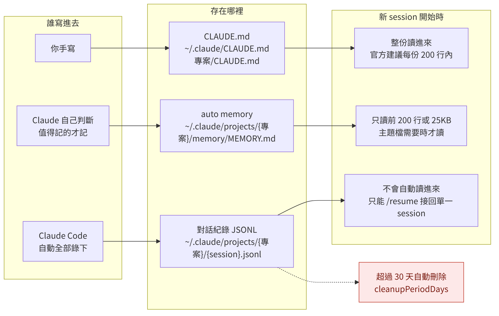

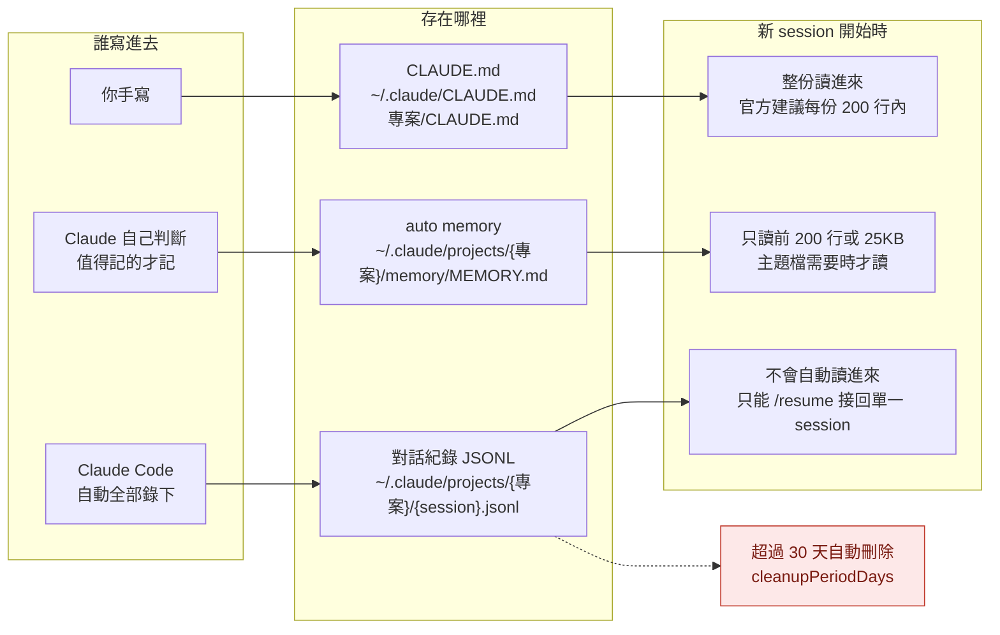

| 層 | 放什麼 | 誰維護 | 新 session 讀不讀 | 會不會過期 |
| --- | --- | --- | --- | --- |
| CLAUDE.md | 不變的規則與專案常識 | 人 | 整份讀，`/compact` 後也會重新讀 | 不會 |
| auto memory | build 指令、除錯心得、架構筆記、偏好 | Claude 自己決定要不要記 | 只讀 `MEMORY.md` 前 200 行或 25KB | 不會，清理不刪記憶檔 |
| JSONL 對話紀錄 | 每句話、每次工具呼叫和結果，完整原文 | Claude Code 自動 | 不會，要用 `/resume` | 預設 30 天後刪除 |

補充幾個教學時常被問的細節：

- auto memory 需要 Claude Code v2.1.59 以上，預設開啟，用 `/memory` 可以查看、編輯、關閉。
- auto memory 只存在這台電腦，不會跨機器同步。
- JSONL 是明文，沒有加密；指令印出的密碼、讀過的 `.env` 都會原封不動寫進去。
- 只在對話裡交代、沒寫進 CLAUDE.md 的指示，`/compact` 之後可能就不見了。

---

## 2. 現場製造痛點：撞牆實驗

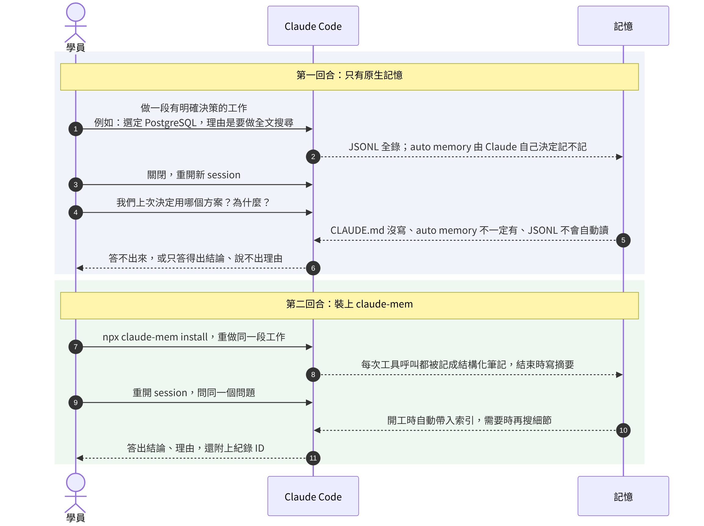

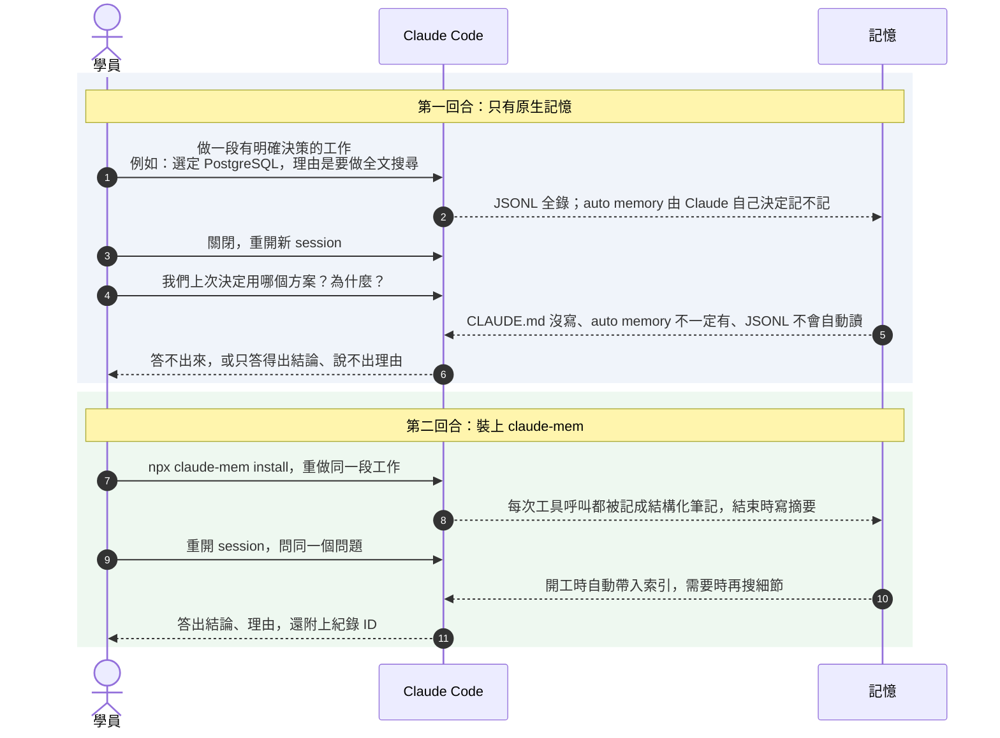

步驟（照原教案）：

1. 做一小段有明確決策的工作，例如選定某個方案並說明理由。
2. 關閉 Claude Code，重新開一個新的 session。
3. 問：「我們上次決定用哪個方案？為什麼？」
4. 學員會看到原生記憶答不出來，或是必須有人事先手動寫進 CLAUDE.md 才答得出來。

> **教學提醒：auto memory 可能讓實驗「沒撞到牆」。** auto memory 由 Claude 自己決定記什麼，有時會剛好把這個決策記下來。建議這樣安排：
> - 第一回合結束後，先用 `/memory` 打開 auto memory，讓學員看它記了什麼、漏了什麼。這本身就是很好的教材：「它有記，但記不記、記多少，由不得你」。
> - 想示範最純粹的情況，第一回合可以暫時關掉 auto memory（`/memory` 裡切換，或設定環境變數 `CLAUDE_CODE_DISABLE_AUTO_MEMORY=1`），第二回合再打開對比。
> - 問題不要只問結論，要問「為什麼」和「當時還考慮過哪些方案」。原生記憶通常只留結論，細節才是 claude-mem 拉開差距的地方。

---

## 3. 原生記憶的限制

| 原教案的說法 | 2026 年 11 月的實際情況 |
| --- | --- |
| 要靠人手動寫，忘了寫就沒有 | **部分成立。** auto memory 會自動記，但由 Claude 自己挑，不保證記到你要的；CLAUDE.md 仍然要人寫。 |
| 無法搜尋，只能整份讀進去，佔用 context | **成立。** CLAUDE.md 整份讀；`MEMORY.md` 超過 200 行或 25KB 的部分開工時不會讀；能「找」的只有 Claude 用 grep 讀檔，沒有語意搜尋。 |
| JSONL 預設 30 天就會被清掉，不是長期保存 | **成立。** `cleanupPeriodDays` 預設 30、最小 1；但 auto memory 檔案不會被這個清理刪掉。 |

---

## 4. 不裝 claude-mem，用 JSONL 自己做一套行不行？

可以。思路是：下班時寫一支腳本，把當天的 JSONL 撈出來，交給 Claude 摘要成筆記，存成 Markdown，下次開工再讓 Claude 讀。但每一步都會碰到問題，紅色就是要自己補的坑。

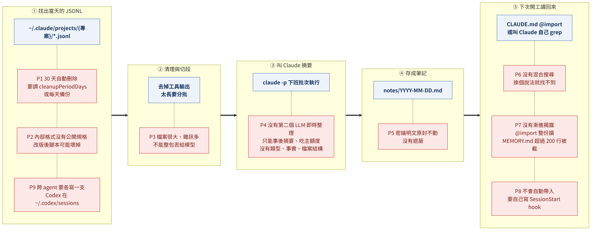

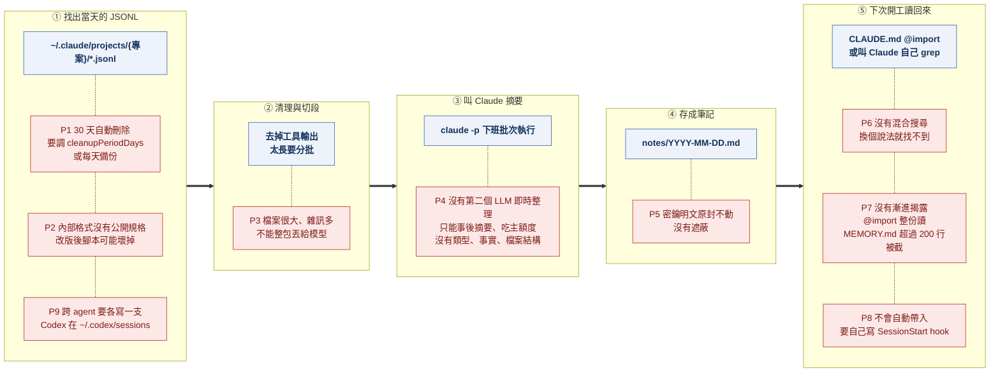

逐一說明：

| # | 問題 | 為什麼會發生 | 自己補要做什麼 |
| --- | --- | --- | --- |
| P1 | 30 天自動刪除 | `cleanupPeriodDays` 預設 30 天，最小 1 | 調大設定值，或每天把 JSONL 備份到別處 |
| P2 | 格式可能改版 | JSONL 是 Claude Code 內部格式，沒有承諾穩定 | 腳本要寫得寬容，改版後跟著修 |
| P3 | 檔案大、雜訊多 | 每次工具輸出都完整記錄；子代理在 `subagents/`、大輸出在 `tool-results/` | 寫清理程式，只留對話與關鍵動作 |
| P4 | 沒有第二個 LLM | 原生沒有「觀察者」在旁邊邊做邊記 | 只能下班批次摘要；吃同一份額度；格式要自己設計 |
| P5 | 密鑰明文 | JSONL 不加密，印出來的東西都在 | 自己寫遮蔽規則，或接受風險 |
| P6 | 沒有混合搜尋 | 原生只能讓 Claude 用 grep 找字 | 自己架 BM25 加向量檢索，等於重做一套 |
| P7 | 沒有漸進揭露 | `@import` 的檔案開工時整份讀；`MEMORY.md` 只讀前 200 行 | 自己維護索引檔，控制長度 |
| P8 | 不會自動帶入 | 筆記檔只是普通檔案 | 寫 SessionStart hook 把摘要注入 |
| P9 | 跨 agent | 每種 agent 紀錄位置與格式不同 | 每種各寫一支解析程式 |

---

## 5. claude-mem 怎麼把這些坑填起來

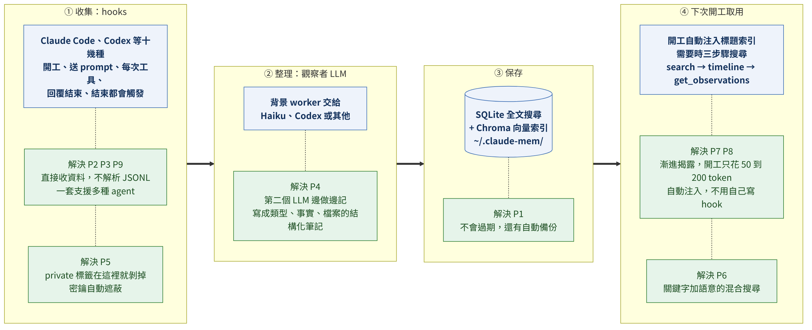

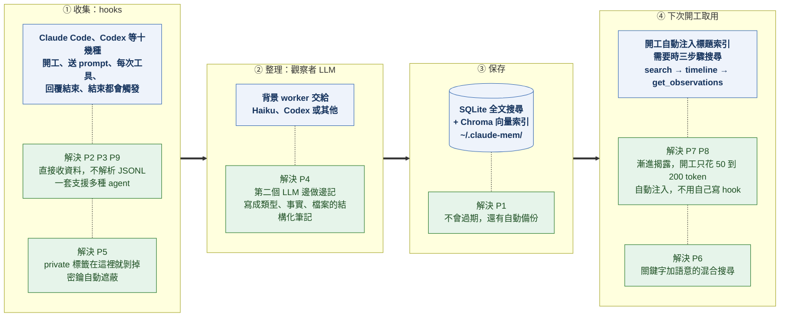

和上一張圖對照著看：同樣是「收集 → 整理 → 保存 → 取用」四段，紅色的坑在這裡都變成綠色。

### 對照總表

| 面向 | 原生：CLAUDE.md + auto memory | 原生：JSONL 自己做 | claude-mem |
| --- | --- | --- | --- |
| 安裝 | 不用 | 不用裝，但要寫腳本 | `npx claude-mem install` |
| 記什麼 | 規則（人寫）＋ Claude 挑的重點 | 什麼都有，看你怎麼摘 | 每次工具呼叫都記，結構化 |
| 誰整理 | 人與 Claude 主對話 | 下班批次用主模型 | 背景的第二個 LLM，即時 |
| 開工自動帶入 | 有，CLAUDE.md 整份、MEMORY.md 前 200 行 | 沒有，要自己寫 hook | 有，只帶標題索引 |
| 搜尋 | 只能 grep | 只能 grep，或自己架 | 內建關鍵字＋語意混合 |
| 保存 | 不過期 | 30 天，要自己備份 | 永久，自動備份 |
| 跨 agent | 只有 Claude Code | 每種各寫一支 | 一套支援十幾種 |
| 隱私 | CLAUDE.md 自己控制 | JSONL 明文 | private 標籤＋自動遮蔽 |
| 額外 token | 幾乎沒有 | 一天一次批次 | 每次工具呼叫都送觀察者，可改吃 Codex 額度 |
| 誰維護 | Anthropic 官方 | 你自己 | 社群開源專案 |
| 公司資安審查 | 最容易 | 容易 | 要審第三方工具、觀察者會把操作內容送到你設定的 AI 服務 |

---

## 6. 記憶方案地圖：你在哪個象限？

橫軸是要花多少力氣設定和維護，縱軸是記憶能力（會不會自動記、記了找不找得到）。位置是教學用的相對示意，不是量測結果。

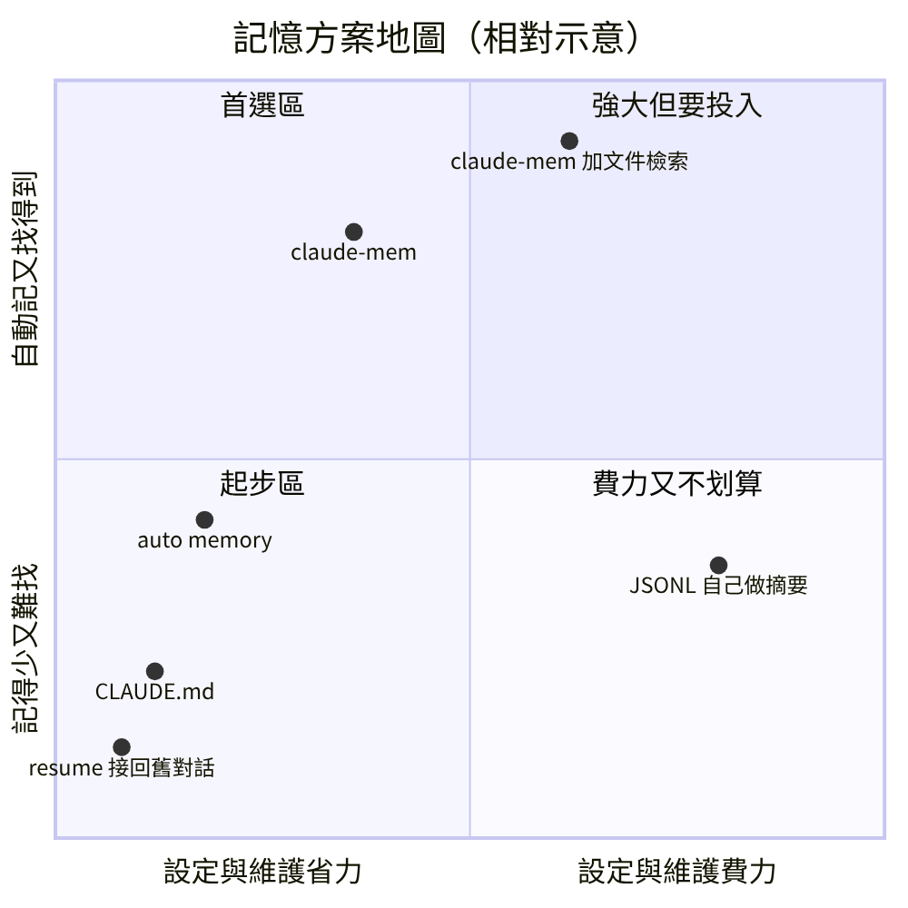

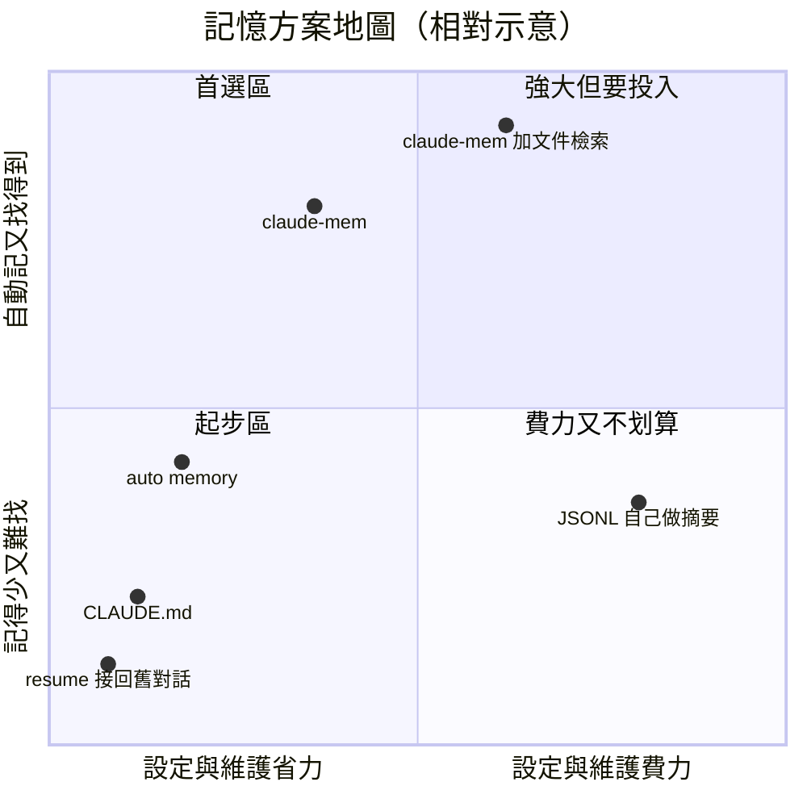

怎麼讀這張圖：

- **起步區（左下）**：每個人都從這裡開始。CLAUDE.md 和 auto memory 不用裝東西，但記得少、找不到。
- **首選區（左上）**：claude-mem 一行安裝，換到「自動記又找得到」，對多數人最划算。
- **強大但要投入（右上）**：再加上文件檢索（INDEX.md 或 knowledge-rag），連數千份文件也查得到，但要整理文件與維護索引。
- **費力又不划算（右下）**：自己解析 JSONL 做摘要，工程量大、能力卻還比不上 claude-mem。只有在「不能裝第三方工具」或「很在意 token」時才值得。

**要往哪裡移動？** 先站穩「起步區」（把規則寫進 CLAUDE.md），再往上移到「首選區」（裝 claude-mem）；手上真的有大量文件要查，才往右上加文件檢索。盡量不要停在右下。

---

## 7. 決策樹：要不要用 claude-mem？

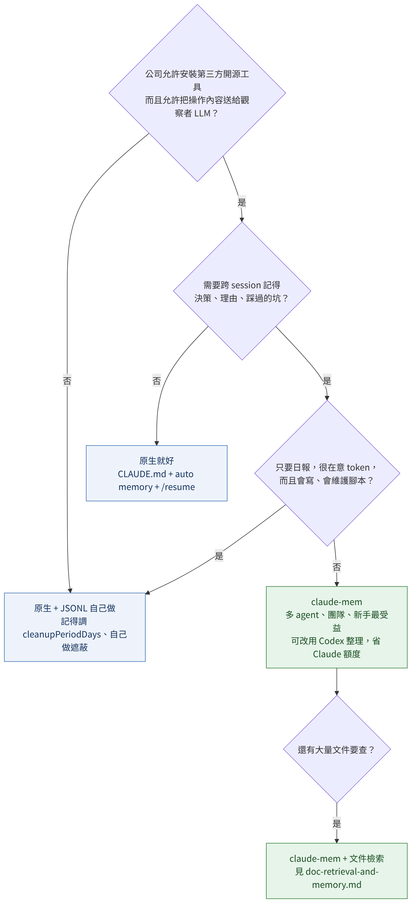

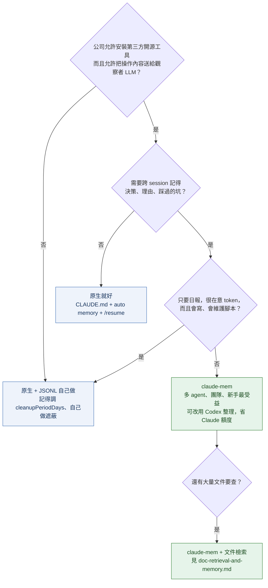

走到 claude-mem 這一格，代表你需要跨 session 記憶、又不想自己維護腳本。同時用多種 agent、要給新手或整個團隊用的人，從它得到的好處最多。

---

## 8. 收尾講分工

| 記憶層 | 放什麼 | 誰維護 |
| --- | --- | --- |
| CLAUDE.md | 不變的規則與專案常識 | 人 |
| auto memory（補充） | Claude 自己覺得重要的筆記 | Claude 自己 |
| claude-mem | 工作過程、決策、踩過的坑 | 自動 |
| 文件檢索（INDEX.md 或 knowledge-rag） | 資料與文件內容 | 工具自動建索引 |

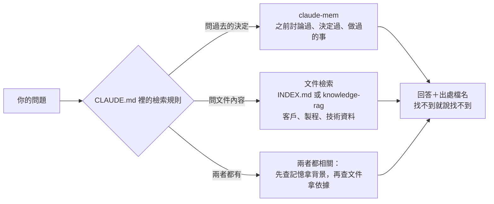

---

## 9. 舊專案的銜接範例

以一個將近一年前的專案重啟為例：claude-mem 無法回溯安裝前的紀錄，所以要先用 Claude Code 讀舊的 JSONL 或程式碼與 git 紀錄，抽出決策與開發過程，整理成 Markdown 放進 CLAUDE.md 或匯入 claude-mem，之後再由 claude-mem 自動接手。清理 JSONL 時先去掉 tool output，體積可大幅縮小。

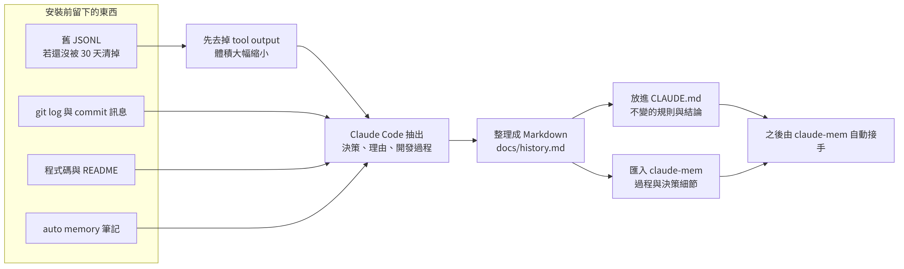

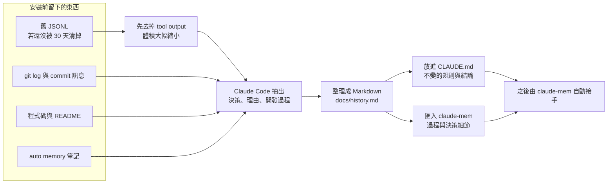

補充：

- 一年前的 JSONL 多半已經被 30 天清理刪掉了，這時主要靠 git 紀錄和程式碼。
- 匯入 claude-mem 的方式：官方文件有「Memory Ingest」頁面，說明如何匯入 Claude Code 的內建記憶檔；也可以用 claude-mem 的匯出、匯入腳本搬移紀錄。細節以官方原文為準。
- 不變的結論放 CLAUDE.md，過程細節放 claude-mem，不要全部塞進 CLAUDE.md，否則每次開工都要整份讀進來。

---

## 來源

- [Claude Code：How Claude remembers your project](https://code.claude.com/docs/en/memory)
- [Claude Code：Claude directory reference](https://code.claude.com/docs/en/claude-directory.md)
- [Claude Code：Settings](https://code.claude.com/docs/en/settings)
- [claude-mem 官方文件](https://docs.claude-mem.ai/introduction)
- 本 repo：[claude-mem 繁中重點整理](claude-mem-zh-tw.md)、[文件檢索與長期記憶](doc-retrieval-and-memory.md)
