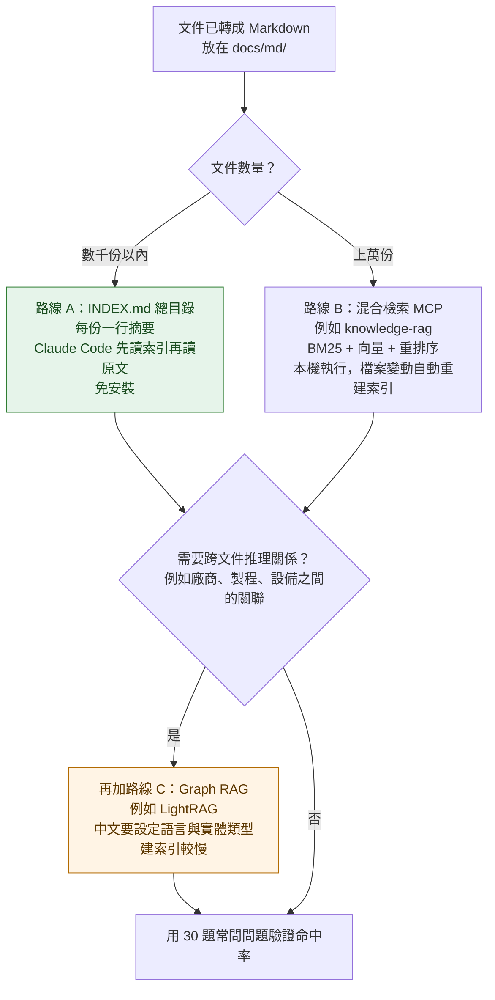
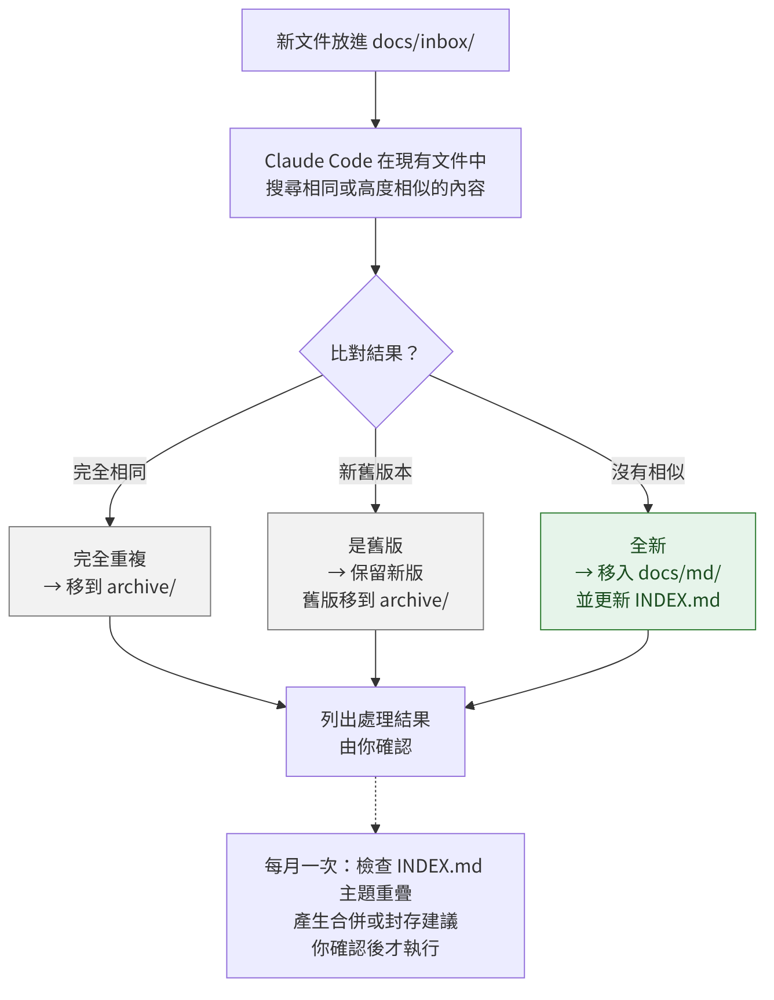
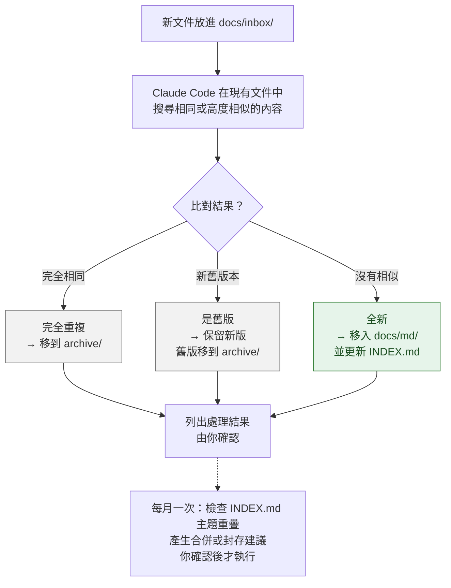
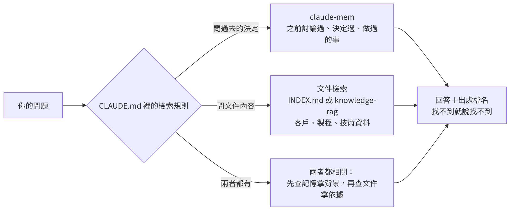
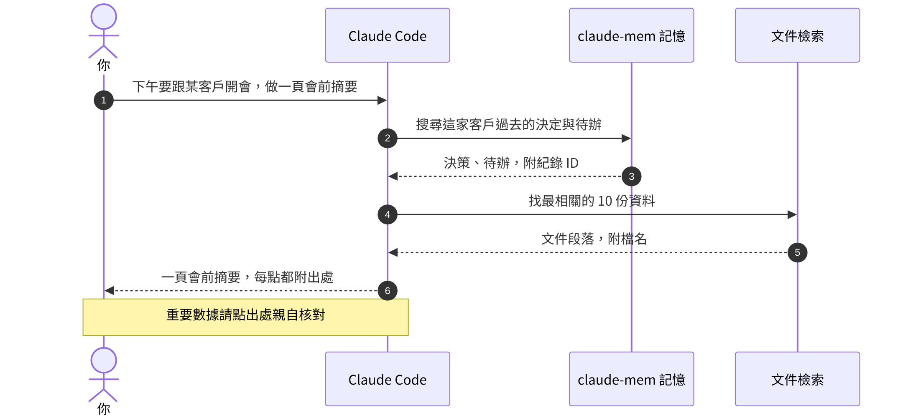
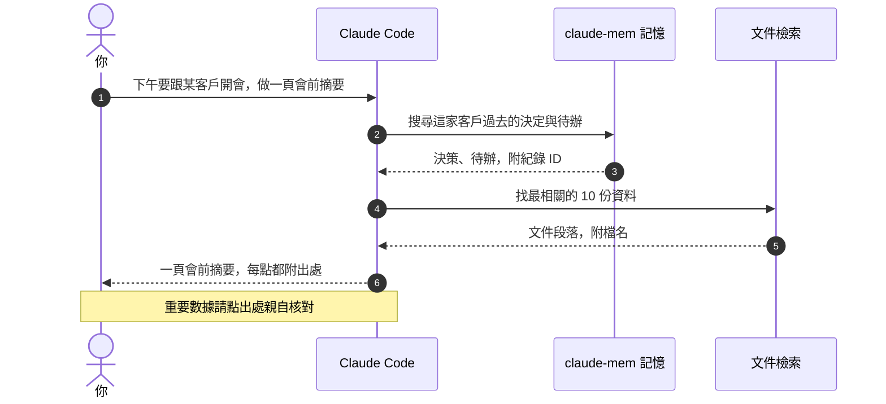

# Claude Code 文件檢索與長期記憶說明

> 資料日期：2026-11-16。knowledge-rag、LightRAG 等工具的安裝與功能細節，以各自的 GitHub 說明為準。

本文件分三部分：

- **第一部分**：如何讓 Claude Code 從大量文件（數千至上萬份，以中文為主）中快速、準確地檢索，並避免重複與越疊越多。
- **第二部分**：如何把檢索工具與 claude-mem 搭配，形成長期記憶。
- **第三部分**：教學大綱「從 Claude Code 原生記憶銜接到 claude-mem」，已擴充成獨立的教學模組並附流程圖，見 [claude-code-to-claude-mem.md](claude-code-to-claude-mem.md)。

---

## 第一部分：文件檢索與去重維護

### 1. 選擇路線

- **路線 A：免安裝（建議先試）**：文件轉成 Markdown，由 Claude Code 產生一份總目錄索引檔，每份文件一行摘要。Claude Code 先讀索引，再用內建搜尋讀取原文。適合數千份以內。
- **路線 B：安裝一個混合檢索 MCP（例如 knowledge-rag）**：BM25 關鍵字檢索加向量語意檢索，再經重排序。單一 Python 程式、本機執行、不需 Docker 或 API key，檔案變動時自動重建索引。適合上萬份。
- **路線 C：Graph RAG（例如 LightRAG）**：僅在需要跨文件推理關係（例如廠商、製程、設備之間的關聯）時再加上。中文需另行設定語言與實體類型，建索引較慢。




### 2. 資料夾結構建議

```
docs/
├── raw/        原始 PDF 與檔案
├── md/         轉換後的 Markdown（檢索的對象）
├── INDEX.md    總目錄索引（路線 A 使用）
├── inbox/      新文件先放這裡，去重後才移入 md/
└── archive/    被判定為重複或過時的文件，不刪除只移出
```

### 3. 路線 A：產生索引的指令範例

可直接對 Claude Code 說：

> 「請掃描 docs/md/ 下所有檔案，為每份文件產生一行摘要，格式為：檔名、主題、關鍵字（中英文都列）、日期。寫入 docs/INDEX.md，依主題分類。已經在 INDEX.md 裡且檔案沒有變動的，跳過不重做。」

### 4. 路線 B：安裝方式

直接請 Claude Code 代為安裝：

> 「請依照 knowledge-rag 的 GitHub 說明，幫我安裝並設定成 Claude Code 的 MCP server，文件目錄指向 docs/md/，完成後用三個問題測試檢索是否正常。」

### 5. 去重與新增文件的流程

多數工具只會跳過「沒有變動的檔案」，不會自動判斷「內容相似但檔名不同」的重複文件，因此新增時加一道關卡：

1. 新文件先放在 `docs/inbox/`。
2. 對 Claude Code 說：「請檢查 docs/inbox/ 的每份文件，先在現有文件中搜尋是否已有相同或高度相似的內容。完全重複的移到 archive；是舊版的，保留新版並把舊版移到 archive；全新的才移入 docs/md/ 並更新 INDEX.md。最後列出處理結果給我確認。」
3. 每月一次請 Claude Code 檢查 INDEX.md 中主題重疊的文件，產生合併或封存建議，由你確認後執行。





### 6. 關於 LLM Wiki 的維護

- 新增文件時不需要全部重整，只更新受影響的頁面即可。
- 但長期下來，頁面之間容易出現矛盾與重複，維護成本會隨文件量上升。上萬份規模時，建議以路線 B 為主，Wiki 只保留少數高價值的主題整理頁。

### 7. 驗證準確度

挑 30 個常問的問題，每題寫下「應該找到的文件」。每次換方法或調整設定後重跑一次，比較命中率。knowledge-rag 內建評估功能，可回報 Recall@5 等指標。

範例測試表：

| # | 常問問題 | 應該找到的文件 | 路線 A 命中 | 路線 B 命中 |
| --- | --- | --- | --- | --- |
| 1 | （例）某製程的良率標準是多少？ | （例）docs/md/製程規範-2026.md | | |
| … | | | | |
| 30 | | | | |

---

## 第二部分：檢索工具搭配 claude-mem 長期記憶

### 1. 分工

- **claude-mem**：記錄過去工作階段的決策、結論、做過的事（「我們之前決定了什麼」）。
- **檢索工具（路線 A 或 B）**：查找文件內容（「文件裡寫了什麼」）。
- 兩者可同時掛在 Claude Code 上，互不衝突。

### 2. 在 CLAUDE.md 寫清楚使用規則

工具本身不會判斷何時該查哪一個，需要在專案根目錄的 CLAUDE.md 寫明。範例：

```markdown
## 檢索規則
- 問到「之前討論過、決定過、做過」的事：先查 claude-mem 記憶。
- 問到客戶、製程、技術資料等文件內容：先查文件檢索（INDEX.md 或 knowledge-rag）。
- 兩者都相關時：先查記憶取得背景，再查文件取得依據。
- 回答時註明出處檔名；找不到時直說找不到，不要猜。
- 新增文件前，先依 docs 去重流程檢查是否重複。
```

這份規則讓 Claude 依問題類型分流，流程見教學模組裡的[記憶分工與查詢路由圖](claude-code-to-claude-mem.md#8-收尾講分工)：



### 3. 開會或任務前的用法

可對 Claude Code 說：

> 「下午要跟某客戶開會，請先從記憶中整理過去跟這家客戶的所有決定與待辦，再從文件中找出最相關的 10 份資料，做成一頁會前摘要，每點都附出處。」





### 4. 讓記憶保持乾淨

- 重要結論在工作階段結束前明確說出來，例如「記住：我們決定採用 knowledge-rag」，方便被記錄。
- 定期請 Claude Code 檢查記憶中是否有過時或互相矛盾的內容，列出後由你確認刪改。

### 5. 合理期待

這套搭配可以做到「大多數時候撈得對」，但不保證百分之百正確。重要的數據與決策，請以附上的出處文件親自核對。

---

## 第三部分：教學大綱

「從 Claude Code 原生記憶銜接到 claude-mem」的完整教案、所有流程圖與決策分析，見 [claude-code-to-claude-mem.md](claude-code-to-claude-mem.md)。
